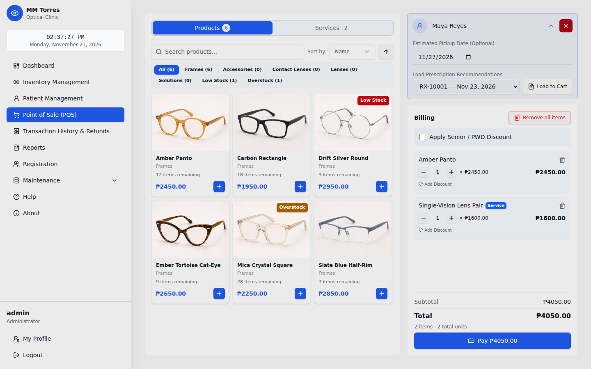

# MM Torres Optical Clinic Management System

A React and Spring Boot web application for running an optical clinic. Record patient visits and eye exams, write prescriptions, manage eyewear stock, and use prescription recommendations to build a sale at the point of sale.

## Screenshot



The screenshot uses fictional clinic records and sample product photos from a fresh PostgreSQL database outside the repository.

## Features

- Patient profiles with visit history, eye exams, prescriptions, and follow-ups.
- A point of sale for products and services that can load recommendations from a patient's prescription and record an estimated pickup date.
- Cash and GCash payments, prescription deposits, balance payments, receipts, and refunds.
- Inventory management with suppliers, categories, batch and expiry tracking, and stock alerts.
- A clinic dashboard and PDF reports for inventory, transactions, and patient activity.
- Administrator and staff accounts, activity logs, and database backup and restore.

## Requirements

- JDK **17 or newer**. The Maven wrapper downloads Maven 3.9.11 on first use.
- Node.js **20.19+** on the 20.x line or **22.12+**, and npm.
- PostgreSQL with the `fuzzystrmatch` extension available. The included Compose configuration uses PostgreSQL 16.
- Bash and OpenSSL for the local setup commands below, plus internet access for the initial dependency downloads.

The frontend uses React, TypeScript, and Vite. The backend uses Spring Boot and PostgreSQL.

## Installation

```bash
git clone https://github.com/lindtseyyy/mmtorresoptical.git
cd mmtorresoptical
npm --prefix frontend-react ci
(cd backend-spring && ./mvnw dependency:go-offline)
```

With PostgreSQL running, use your PostgreSQL administrator account to create a login and an empty database. `createuser` prompts for the new login's password.

```bash
createuser --pwprompt optical_clinic
createdb --owner=optical_clinic mmtorresoptical
```

Copy the backend environment template once.

```bash
cp backend-spring/.env.example backend-spring/.env
chmod 600 backend-spring/.env
```

In `backend-spring/.env`, set `SPRING_DATASOURCE_URL` to `jdbc:postgresql://127.0.0.1:5432/mmtorresoptical`, `SPRING_DATASOURCE_USERNAME` to `optical_clinic`, and `SPRING_DATASOURCE_PASSWORD` to the password you chose. Quote values that contain shell special characters. Use separate random values for `JWT_SECRET` and `HASH_PEPPER` from `openssl rand -hex 32`, and generate `ENCRYPTION_SECRET_KEY` with `openssl rand -hex 16`. Keep the same values when restarting against the same database.

## Usage

From the repository root, start the backend.

```bash
cd backend-spring
set -a
source .env
set +a
./mvnw spring-boot:run
```

In a second terminal, start the frontend from the repository root.

```bash
npm --prefix frontend-react run dev -- --host 127.0.0.1
```

1. Open `http://127.0.0.1:5173`. On a fresh database, sign in as `admin` with the initial password `admin123` and complete the prompted password and recovery setup.
2. Add a frame in **Inventory Management** and receive stock for it. Add any services you want to offer at checkout.
3. In **Patient Management**, create a patient and write a prescription with product recommendations.
4. Open **Point of Sale**, choose **Associate Patient**, select the prescription, and click **Load to Cart**. Review the billing total, then proceed to payment.
5. Use **Transaction History & Refunds** to review receipts, collect remaining balances, or process refunds.

### Docker Compose

With Docker and the Compose plugin installed, run the following once from the repository root for a fresh database. The shell refuses to overwrite an existing `.env` file.

```bash
(
  umask 077
  set -o noclobber
  {
    printf 'POSTGRES_PASSWORD=%s\n' "$(openssl rand -hex 32)"
    printf 'JWT_SECRET=%s\n' "$(openssl rand -hex 32)"
    printf 'ENCRYPTION_SECRET_KEY=%s\n' "$(openssl rand -hex 16)"
    printf 'HASH_PEPPER=%s\n' "$(openssl rand -hex 32)"
  } > .env
)
docker compose up -d
```

Open `http://localhost` and complete the first-run account setup described above. PostgreSQL is available to Spring at `db:5432`. If a host tool needs direct database access, use a local Compose override that publishes `127.0.0.1:5433:5432`.

For an existing Compose database, keep the current volume, Compose project name, and application secrets. Before bringing up the revised configuration, open `psql` in the running database container:

```bash
docker exec -it postgres_db_mmtorres psql -U postgres -d mmtorresoptical
```

Use `\password postgres` at the prompt to set a new password. Set `POSTGRES_PASSWORD` to the same value in the root `.env`, then run `docker compose up -d` under the existing project name. The variable initializes the password on a fresh volume. On an existing volume, the password change in `psql` takes effect immediately.
